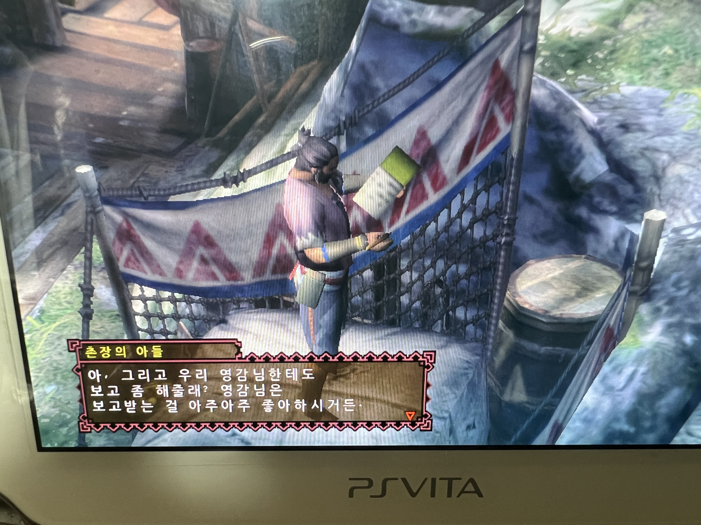

# Monster Hunter 3 Tri (PS Vita) - CJK Text Truncation & Dialogue Cutoff Fix

[English](README.md) | [한국어](README_KR.md)

Patched binaries and engine bug fixes for the [Grarak/mh3-wii](https://github.com/Grarak/mh3-wii) PS Vita static recompilation port, resolving dialogue truncation (11-character cutoff) and UI menu buffer overflow issues for CJK (Korean, Japanese, Chinese) and custom language packs.

<p align="center">
  
</p>

---

## 🌟 Fixed Issues

### 1. NPC Dialogue 11-Character Cutoff Fix (`debug_font.cpp` / `flKnjMsgNumPtr`)
* **Problem**: In the original Vita port, custom imported font glyphs had their `narrow` property initialized to `0` (wide). This caused the engine's column counter (`Columns()`) to return `2` for every imported character. Because the NPC typewriter dialogue engine imposes a strict 22-column limit per line, in-game typewriter dialogues were truncated at exactly **11 characters** (`11 characters × 2 columns = 22 columns`).
* **Fix**: Patched `Columns`, `TextAfterColumns`, `MH3_FontTextColumns`, and `GlyphColumns` to count wide/CJK glyphs as 1 column within line-budget calculations while preserving the full visual rendering width on screen. Full 20~22+ character sentences now display completely without truncation.

### 2. Menu UI Text Buffer Overflow Fix (`MH3_FontPutsText`)
* **Problem**: In static UI menus (such as the Save File Selection screen), the glyph counter was incremented twice per rendered character, cutting the usable text buffer capacity in half.
* **Fix**: Fixed the double-increment logic so that multi-line descriptions (20~24+ characters per line) render smoothly without clipping or crashing.

---

## 📥 Installation

### Option A: Clean Install (VPK)
1. Download `mh3-vita-kr.vpk` from the Releases section and install it using **VitaShell**.
2. Place your legally obtained, extracted Monster Hunter 3 Tri Wii PAL (RMHP08) game data into:
   ```text
   ux0:data/mh3-wii/
   ```
3. (Optional) Place your custom language JSON file (e.g. `template.json`) into:
   ```text
   ux0:data/mh3-wii/languages/
   ```
4. Launch the game from LiveArea.

### Option B: Quick Update for Existing Installations (Recommended)
If you already have the game installed on your PS Vita:
1. Download `eboot.bin` from the Releases section.
2. Open **VitaShell**, connect your PS Vita to your PC via USB or FTP, and replace:
   ```text
   ux0:app/MH3WII001/eboot.bin
   ```
3. Launch the game.

---

## 📜 Credits & License

* Original Static Recompiler & PS Vita Port: [Grarak/mh3-wii](https://github.com/Grarak/mh3-wii)
* License: [GNU General Public License v3.0 (GPL-3.0)](https://www.gnu.org/licenses/gpl-3.0.html)
* **Disclaimer**: This project does not contain any copyrighted game assets, audio, textures, or proprietary Capcom ROM files. Users must supply their own game files extracted from a legally owned copy of the game.
# mh3-vita-kr
