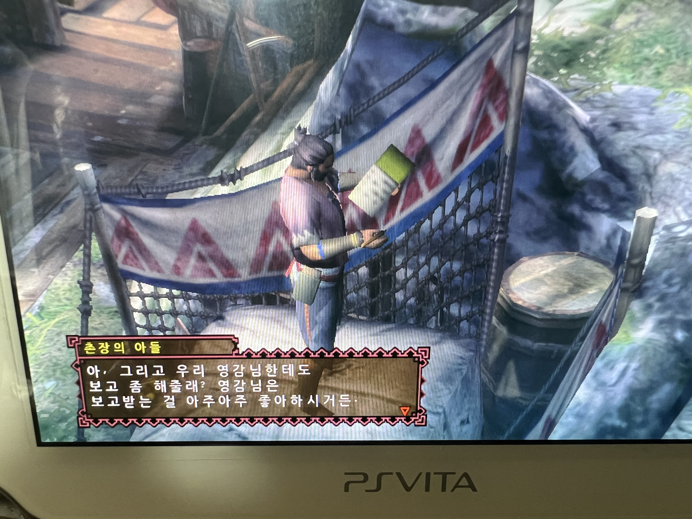

# 몬스터 헌터 3 트라이 (PS Vita) - CJK / 한글 텍스트 잘림 및 대화창 11자 버그 수정 패치

[English](README.md) | [한국어](README_KR.md)

[Grarak/mh3-wii](https://github.com/Grarak/mh3-wii) 프로젝트 기반의 PS Vita용 몬스터 헌터 3 트라이(Monster Hunter 3 Tri) 정적 재컴파일 포팅에서 CJK(한국어, 일본어, 중국어) 및 커스텀 언어 팩 적용 시 발생하던 **NPC 대화창 11자 절단 현상**과 **메뉴 UI 버퍼 오버플로 버그**를 수정한 바이너리 패치입니다.

<p align="center">
  
</p>

---

## 🌟 주요 수정 내역

### 1. NPC 대화창 11글자 절단 버그 수정 (`debug_font.cpp` / `flKnjMsgNumPtr`)
* **원인**: 원작 비타 이식판 소스코드에서 외부 폰트 글리프를 불러올 때 `narrow` 속성을 `0`(와이드)으로 설정하여, 엔진 내부의 컬럼 계산 함수(`Columns()`)가 글자당 `2`를 반환하도록 되어 있었습니다. 인게임 NPC 대화창은 한 줄당 **22칸(컬럼)** 한도를 사용하므로, `11글자 × 2 = 22칸`이 되어 **타자기 효과 대사가 정확히 11글자에서 잘리는 문제**가 발생했습니다.
* **수정**: 실제 화면 렌더링 폭은 유지하되, 대화창 칸 수 계산(`Columns`, `TextAfterColumns`, `MH3_FontTextColumns`, `GlyphColumns`)에서 글자당 1칸으로 계산하도록 패치하여 **한 줄당 최대 20~22글자까지 잘림 없이 온전히 표시**되도록 수정했습니다.

### 2. 메뉴 UI 텍스트 버퍼 오버플로 수정 (`MH3_FontPutsText`)
* **원인**: 저장 파일 선택 화면 등 정적 UI 창에서 글자 수 카운터가 글리프당 2회씩 증가하여 가용 텍스트 버퍼 용량이 절반으로 줄어들고 긴 문장이 잘리던 버그를 수정했습니다.
* **수정**: 한 줄당 20~24글자 이상의 긴 설명 문구 및 2줄 이상의 줄바꿈 안내 텍스트가 정상적으로 모두 표시됩니다.

---

## 📥 설치 방법

### 방법 A: 새로 설치하는 경우 (VPK)
1. Releases 탭에서 `mh3-vita-kr.vpk`를 다운로드하여 **VitaShell**로 설치합니다.
2. 정품 Wii 몬스터 헌터 3 유럽판(RMHP08) 디스크에서 추출한 게임 데이터를 아래 경로에 넣습니다:
   ```text
   ux0:data/mh3-wii/
   ```
3. (선택 사항) 사용자가 제작한 커스텀 언어 파일(예: `template.json`)이 있는 경우 아래 경로에 넣습니다:
   ```text
   ux0:data/mh3-wii/languages/
   ```
4. 라이브에리어에서 게임을 실행합니다.

### 방법 B: 기존 설치 유저 빠른 업데이트 (권장)
이미 비타에 몬스터 헌터 3가 설치되어 있는 경우:
1. Releases 탭에서 `eboot.bin`을 다운로드합니다.
2. **VitaShell**을 실행하고 비타를 PC에 연결(USB/FTP)한 뒤, 아래 경로에 `eboot.bin`을 덮어씁니다:
   ```text
   ux0:app/MH3WII001/eboot.bin
   ```
3. 게임을 실행하면 즉시 패치가 적용됩니다.

> [!IMPORTANT]
> **기존 언어 캐시 파일 삭제 (`.mh3lang`) (가장 중요 ⭐)**:
> 번역 JSON 파일(예: `template.json`)을 새로 넣거나 수정한 경우, `languages` 폴더 안에 이미 컴파일되어 생성되어 있는 **`ko.mh3lang`** (또는 `*.mh3lang`) 캐시 파일을 반드시 **삭제(Delete)**해 주셔야 합니다:
> ```text
> ux0:data/mh3-wii/languages/ko.mh3lang
> ```
> 이 캐시 파일이 남아있으면 게임 엔진이 수정된 JSON을 다시 읽지 않고 기존 캐시를 그대로 로드하여 번역이나 폰트 변경 사항이 전혀 반영되지 않습니다. (`ko.mh3lang`을 삭제하고 게임을 실행하면 수정된 JSON을 바탕으로 새 캐시 파일이 자동 생성됩니다.)

---

## 📜 크레딧 및 라이선스 (Credits & License)

* 원작 정적 재컴파일러 및 PS Vita 포팅: [Grarak/mh3-wii](https://github.com/Grarak/mh3-wii)
* 라이선스: [GNU General Public License v3.0 (GPL-3.0)](https://www.gnu.org/licenses/gpl-3.0.html)
* **저작권 안내**: 본 프로젝트는 캡콤(Capcom)의 롬 파일, 텍스트 스크립트, 음원, 3D 모델 등 저작권이 있는 자산을 포함하지 않습니다. 게임 구동에 필요한 정품 데이터는 사용자가 직접 보유한 게임에서 추출해야 합니다.
